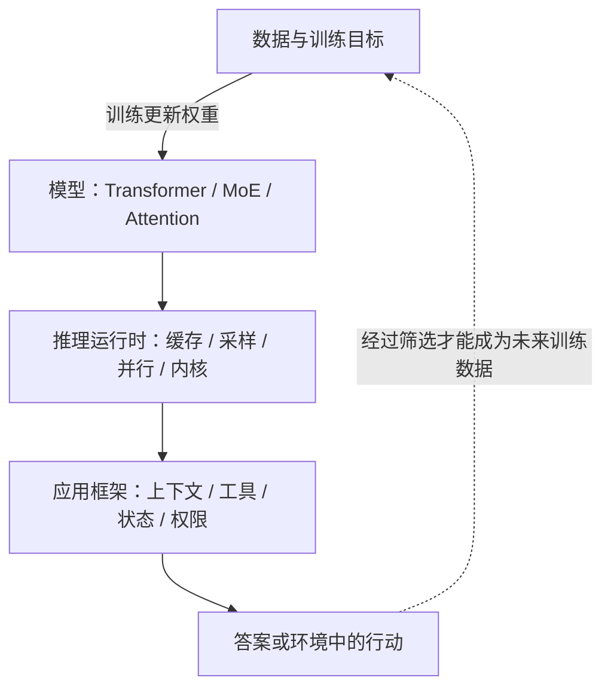
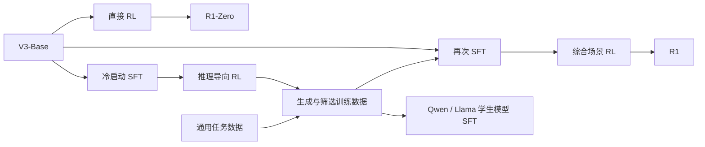
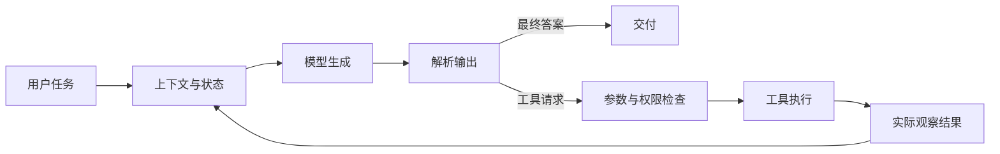

# Learn DeepSeek Reasoning

**从公开论文走到代码：理解 DeepSeek 的推理训练、模型架构与运行框架。**

中文 · 中等深度 · 8 个主题 · 5 个离线实验 · Python 标准库

这份笔记面向会一点 Python、希望读懂大模型技术但不准备从头训练大模型的读者。建议先用 30–45 分钟读正文，再用 20 分钟运行实验。公式只保留帮助理解机制的部分。

我的中心理解是：**训练改变模型倾向于生成什么，架构决定这些计算怎样组织，推理系统决定计算怎样执行，应用框架决定结果怎样作用于环境。** 把这四层分开，许多关于“思考”的误解就容易辨认。

> 范围与版本：基础主线是 **DeepSeek-R1 2025 年初版**与 **DeepSeek-V3**；第 8 节补充 V3.2、V4 和新公开应用框架的阅读入口。资料核查日期为 **2026-11-03**，不将 R1/V3 宣称为最新模型。本文是独立学习解析，不代表 DeepSeek 官方，也不提供其未公开的训练流水线或内部心理过程。

## 阅读路线

| 章节 | 要回答的问题 | 抓住一个机制 |
|---|---|---|
| [01 四层地图](#s01) | “思考逻辑”到底指什么？ | 区分训练、结构、执行、应用 |
| [02 R1 训练](#s02) | 推理行为如何被训练出来？ | 从结果反馈改变生成倾向 |
| [03 GRPO](#s03) | 同题多答怎样变成学习信号？ | 组内相对优势 |
| [04 V3 架构](#s04) | 大容量怎样控制计算与缓存？ | MoE 与 MLA |
| [05 推理与蒸馏](#s05) | 多想、筛选和学习有什么差别？ | 预算、数据与权重 |
| [06 官方源码](#s06) | 应该从哪几个函数开始读？ | 一次 token 生成的调用路径 |
| [07 评测与判断](#s07) | 如何判断真的更好？ | 正确率与资源预算一起比较 |
| [08 版本与框架](#s08) | 新版本改变了哪一层？ | 模型、协议适配与 Harness 分工 |

## 先运行一个实验

仅需 Python 3.10+，无需 GPU、模型权重、API Key 或第三方依赖。在仓库根目录运行：

```bash
python3 examples/s01_grpo.py
python3 examples/s02_moe.py
python3 examples/s03_mla_cache.py
python3 examples/s04_evaluation.py
python3 examples/s05_harness.py
python3 -m unittest discover -s tests -v
```

这些是**机制演示**：数值和输入均为明确标注的教学构造，不是 DeepSeek 的实测输出。示例没有神经网络训练、梯度更新或真实模型调用。具体预期结果见 [实验指南](examples/README.md)。

<a id="s01"></a>
## 01 · 先建立四层地图

“DeepSeek 的框架”至少可能指四件不同的事。



| 层 | 可以观察什么 | 不能据此断言什么 |
|---|---|---|
| 训练方法 | 论文中的目标、数据流程、消融实验 | 已拿到全部训练数据和生产训练代码 |
| 模型结构 | 参数配置、张量变换、路由与注意力 | 每个专家对应一个人类学科 |
| 推理运行时 | token 生成、缓存、停止条件、并行策略 | 生成了“反思”文字就一定纠正了错误 |
| 应用框架 | 工具请求、执行结果、对话与任务状态 | 外部循环就是模型内部的推理算法 |

阅读证据也要分层。全文的“**公开事实**”指材料明确支持的内容；“**我的理解**”是解释与推论；“**教学简化**”是便于实验而主动省略的机制。

例如，模型写出“检查刚才的答案”，只能直接证明它生成了这段文本。要判断检查是否有效，应比较检查前后答案是否正确、依据是否成立。要研究这些文字是否忠实反映内部计算，则需要额外实验。公开推理文本不是完整的神经活动记录。

同样，“开源”也不是一个覆盖所有层的单一开关。R1 仓库提供报告、模型入口等材料；V3 仓库另外有推理实现。就本文检查的仓库而言，没有得到足以从头重训 R1 的完整训练流水线与数据。[R1 仓库](https://github.com/deepseek-ai/DeepSeek-R1) · [V3 仓库](https://github.com/deepseek-ai/DeepSeek-V3)

<a id="s02"></a>
## 02 · R1：把“会解题”与“会交付”一起训练

**公开事实。** 初版 R1-Zero 从已经预训练的 V3-Base 出发，直接进行强化学习，没有先做监督微调。这里的 Zero 不表示随机初始化，也不表示模型没有学习过语言、代码或数学。R1 则使用冷启动数据，并组合两轮 SFT 与两轮 RL；初版蒸馏模型使用筛选数据进行 SFT。[官方介绍](https://github.com/deepseek-ai/DeepSeek-R1#2-model-summary)



一个容易画错的细节：论文描述的第二轮 SFT 是用筛选后的数据微调 **V3-Base**，不能简单画成“第一轮 RL 检查点一路继续 SFT”。R1-Zero 主要使用正确性与格式奖励；最终综合 RL 还涉及通用偏好目标。不能把“规则奖励”推广成整个系列永远不用神经奖励模型。[R1 论文 §2.2–2.4](https://arxiv.org/html/2501.12948v1)

**我的理解：这是一条“探索—整理—再学习”的路线。**

把它想成一道教学设计题：一个学习者可能找到正确解法，却把答案写得混乱；也可能写得整齐，却算错。前一种问题需要表达与交付约束，后一种需要可靠的正确性反馈。单独优化其中一项，不能自动获得另一项。

冷启动示例帮助模型进入合适的表达分布；结果反馈帮助它调整求解行为；筛选后的示例把探索成果变成更稳定的学习材料。这是对流程的解释，并不意味着能从公开文字重建每一道训练题或每一步优化。

**关键反例。** 如果奖励只检查最终答案恰好等于 `42`，一个胡编过程但输出 `42` 的回答也可能得分。结果奖励有助于优化结果，却不能保证每一个中间步骤都是有效证明。设计验证器时，必须清楚自己到底在奖励什么。

读完这一节，应该能回答：为什么“没有 SFT 的 R1-Zero”和“没有预训练的模型”是完全不同的概念？

<a id="s03"></a>
## 03 · GRPO：同一道题的候选答案互相提供参照

**公开事实。** GRPO 在 DeepSeekMath 中提出。它从旧策略对同一问题采样一组输出，用组内奖励构造优势，不额外训练 PPO 式的价值模型。其目标包含概率比率裁剪和相对参考策略的 KL 约束。[DeepSeekMath §4.1](https://arxiv.org/html/2402.03300v1#S4.SS1)

先只看最容易理解的一步。对于同题候选的奖励 `r_i`，写作：

```text
advantage_i = (reward_i - group_mean) / (group_std + tiny_epsilon)
```

`tiny_epsilon` 是本仓库教学实现的数值防护；论文公式直接写标准差。示例采用总体标准差，并在全组同分时返回零优势。真实实现应核对其标准差约定和零方差处理。

假设同一道题的四个候选得到：

| 候选 | 奖励 | 组内优势 |
|---|---:|---:|
| A | 1 | +1 |
| B | 0 | -1 |
| C | 1 | +1 |
| D | 0 | -1 |

直觉是：相对同题其他候选表现更好的输出，为更新策略提供正向信号。这不是把四段答案投票选出一段，也不是把 A 的文本直接写进一个规则库。

更接近真实目标的概念骨架是：

```text
ratio = current_token_probability / old_token_probability
surrogate = min(ratio * advantage,
                clip(ratio, 1-epsilon, 1+epsilon) * advantage)
objective = average(surrogate) - beta * KL(current_policy, reference_policy)
```

这是解释符号作用的骨架，省略了序列归一化、token 掩码、采样与梯度等细节。旧策略提供采样与比率分母；参考策略提供约束锚点，二者职责不同。

运行 [s01_grpo.py](examples/s01_grpo.py)，观察三组输入：有输有赢、全部正确、全部错误。后两组的组内优势都为零。这说明：**“绝对上很差”不一定产生“组内可区分”的学习信号。** 此时 KL 项仍可能产生影响；零的是这里的相对奖励优势，并非所有训练项。

**我的理解。** 有效反馈取决于候选的差异和验证器的质量。若一组答案全错、评分无法区分，或者验证器存在漏洞，单纯增加采样数量不保证学得更好。应先检查题目难度与评分是否产生有用区分。

<a id="s04"></a>
## 04 · V3：让容量、计算与缓存分别可控

本节只解释 V3/R1 基础主线，后续版本不要直接套用全部结构。

### MoE：每个 token 选择部分专家参与计算

**代码事实。** V3 的 671B 配置中，路由专家数是 256，每个 token 选择 8 个，并有 1 个共享专家；前 3 层使用稠密前馈模块。`Gate.forward()` 产生路由选择与权重，`MoE.forward()` 汇总专家输出。[配置](https://github.com/deepseek-ai/DeepSeek-V3/blob/9b4e9788e4a3a731f7567338ed15d3ec549ce03b/inference/configs/config_671B.json) · [Gate / MoE](https://github.com/deepseek-ai/DeepSeek-V3/blob/9b4e9788e4a3a731f7567338ed15d3ec549ce03b/inference/model.py#L535)

```text
一个 token 的隐藏向量
    ├── 共享专家 ────────────────────┐
    └── Gate → 选中若干路由专家 → 加权求和 ─┤→ 合并输出
```

**我的理解。** 这更像在一组可学习的计算模块中分配工作。专家接收的是向量；它不是独立聊天机器人。把专家命名为“数学家”“程序员”可以帮助想象，却不是源码给出的语义保证。

运行 [s02_moe.py](examples/s02_moe.py)：四个虚构专家只选择两个。演示还刻意保留一个容易忽略的细节——**选择分数与混合权重可以不同**。参考实现中的路由偏置用于选择专家，最终权重取自原始分数。教学程序省略专家分组、矩阵网络、分布式通信与训练时偏置更新。

V3 报告给出总参数 671B、每 token 激活约 37B。激活参数少意味着部分计算稀疏，不代表只需存放 37B 权重。实际部署仍要考虑全部权重、分片、缓存、临时空间与通信。[V3 官方介绍](https://github.com/deepseek-ai/DeepSeek-V3#1-introduction)

### MLA：缓存压缩表示，再完成注意力计算

**代码事实。** `MLA` 的 `absorb` 路径缓存低维 `kv_cache` 与独立的 `pe_cache`，而 `naive` 路径显式缓存各头 K/V。矩阵吸收让部分计算在压缩空间中完成。[MLA 实现](https://github.com/deepseek-ai/DeepSeek-V3/blob/9b4e9788e4a3a731f7567338ed15d3ec549ce03b/inference/model.py#L396)

可以先研究一个理想化存储问题：在相同精度、忽略分片和额外元数据时，每 token、每层缓存多少个数？

```text
同维度朴素展开：heads × (nope_key_dim + rope_key_dim + value_dim)
MLA absorb：latent_kv_dim + rope_key_dim

V3 配置代入：
展开：128 × (128 + 64 + 128) = 40,960
压缩：512 + 64 = 576
```

运行 [s03_mla_cache.py](examples/s03_mla_cache.py) 会得到约 `71.11` 倍的**此特定缓存元素数比值**。这不是推理速度倍数，也不是相对于 GQA、优化后共享位置缓存或所有模型的通用压缩比。程序只做容量算术，没有执行注意力。

**我的理解。** MoE 回答“哪些计算模块参与”，MLA 回答“历史注意力信息怎样保存与使用”。一个主要处理模型容量和计算分配，另一个主要处理缓存与注意力计算。二者可以共同降低某些成本，但不会替代推理训练。

### 还有两项容易误读的设计

V3 的 MTP 在训练时增加未来 token 预测目标，也可用于推测解码；它不等于固定生成多段“思考”。其辅助损失无关负载均衡方法之外，报告仍保留很小的序列级平衡辅助损失，所以不能概括为“所有辅助损失都消失了”。[V3 报告 §2](https://arxiv.org/html/2412.19437v1#S2)

<a id="s05"></a>
## 05 · 推理、筛选、蒸馏：三个不同的时间尺度

这里把“推理”分成两个语义：reasoning 是求解行为，inference 是运行已训练模型。一次 inference 可以包含较长的 reasoning 文本，但通常不更新权重。

| 操作 | 当前改变什么 | 是否必然更新模型权重 |
|---|---|---|
| 生成更长答案 | 本次序列与计算量 | 否 |
| 同题采样多次 | 候选集合 | 否 |
| 投票或验证器筛选 | 最终选出的答案 | 否 |
| 用筛选数据做 SFT | 模型生成分布 | 是 |
| 用奖励做 RL | 模型策略 | 是 |

**我的理解。** “这次答得更好”和“以后更容易答好”是两件事。一个推理系统可以在不改权重的情况下，通过增加候选或验证提升本次成功机会；训练则试图把改进写进参数。两者的成本发生在不同阶段。

初版 R1-Distill 学生基于 Qwen/Llama 的稠密模型，由教师生成并筛选的数据进行微调。因此小模型不必继承教师的 MoE 与 MLA。蒸馏可以传递行为模式，不等于从大模型里剪下一块权重；初版发布流程也不应描述成复制教师所有 token 的完整概率分布。[官方蒸馏说明](https://github.com/deepseek-ai/DeepSeek-R1#2-model-summary)

试想一道需要八步推导的题：更长的预算允许写完八步，但也可能多写十段重复内容。更大的候选集合能增加遇到好解的机会，但如果选择器总选最流畅的错解，候选再多也未必有用。

因此我会把推理预算视为一种可测量资源：增加预算后，成功率、耗时、token 消耗和失败类型怎样变化？把“更长”直接当作“更聪明”，会跳过真正需要验证的环节。

<a id="s06"></a>
## 06 · 从官方代码读一次 token 生成

读源码时，先沿数据路径走一遍，再回头研究优化。以下链接固定到 V3 提交 `9b4e9788e4a3a731f7567338ed15d3ec549ce03b`，避免行号随主分支漂移。

```text
generate()
  → Transformer.forward(tokens, start_pos)
      → embedding
      → 多个 Block
          → MLA
          → 稠密 MLP 或 MoE
      → norm 与词表输出头
  → sample() 或贪心选择
  → 更新 token 序列与停止状态
```

| 阅读顺序 | 代码入口 | 核对什么 |
|---|---|---|
| 1 | [generate.py：generate](https://github.com/deepseek-ai/DeepSeek-V3/blob/9b4e9788e4a3a731f7567338ed15d3ec549ce03b/inference/generate.py#L31) | prompt、当前位置、输出上限、EOS 如何控制循环 |
| 2 | [Transformer.forward](https://github.com/deepseek-ai/DeepSeek-V3/blob/9b4e9788e4a3a731f7567338ed15d3ec549ce03b/inference/model.py#L773) | token 怎样变成词表 logits |
| 3 | [Block](https://github.com/deepseek-ai/DeepSeek-V3/blob/9b4e9788e4a3a731f7567338ed15d3ec549ce03b/inference/model.py#L696) | 注意力、前馈、归一化与残差怎样连接 |
| 4 | [MLA](https://github.com/deepseek-ai/DeepSeek-V3/blob/9b4e9788e4a3a731f7567338ed15d3ec549ce03b/inference/model.py#L396) | 缓存哪些张量，如何读取历史位置 |
| 5 | [Gate](https://github.com/deepseek-ai/DeepSeek-V3/blob/9b4e9788e4a3a731f7567338ed15d3ec549ce03b/inference/model.py#L535) | `scores`、`original_scores`、top-k 的关系 |
| 6 | [MoE](https://github.com/deepseek-ai/DeepSeek-V3/blob/9b4e9788e4a3a731f7567338ed15d3ec549ce03b/inference/model.py#L636) | 路由专家、共享专家和跨设备归并 |

一个实用检查：`ModelArgs` 的默认参数不等于 671B 模型的真实配置。阅读前先打开对应 JSON，再解释维度和专家数量。

**工程框架也不是一个文件。** 官方还公开了以下组件：

| 项目 | 主要解决的问题 | 本文理解 |
|---|---|---|
| [DeepEP](https://github.com/deepseek-ai/DeepEP) | 专家并行通信 | token 如何送到专家并收回结果 |
| [DeepGEMM](https://github.com/deepseek-ai/DeepGEMM) | 高效矩阵乘内核 | 专家等模块中的矩阵计算怎样跑得快 |
| [FlashMLA](https://github.com/deepseek-ai/FlashMLA) | 高效注意力内核 | 数学结构如何映射为高效设备实现 |
| [DualPipe](https://github.com/deepseek-ai/DualPipe) | 流水线调度与计算通信重叠 | 怎样减少设备等待与流水线空泡 |

这些库是理解工程分工的入口，不是一个可以直接拼起来就重训 R1 的完整套件。尤其要区分历史论文中的机制与各库今天的主分支：支持的硬件、接口和服务对象可能已经变化。本文没有编译或基准测试这些 GPU 组件。

<a id="s07"></a>
## 07 · 用可检验的问题评价“思考”

运行 [s04_evaluation.py](examples/s04_evaluation.py)。程序构造同一题五个答案：三个错误答案相同、两个答案正确。你会看到：单次正确率估计为 `0.4`，这组样本至少有一个正确答案，但多数票仍然错误。

这个反例把三种问题分开：

| 指标 | 实际询问 |
|---|---|
| pass@1 | 随机采样一次，答对的概率有多大？ |
| pass@k | 给 k 次机会，至少一次正确的概率有多大？ |
| consensus@k | 用 k 个样本的多数票决定最终答案，结果对不对？ |

示例还计算有限样本估计量 `1 - C(n-c, k) / C(n, k)`，其中 `n` 是总候选数，`c` 是正确候选数。它估计从样本中选 k 个至少有一个正确的比例；“至少有正确候选”不等于用户已经拿到正确答案。[pass@k 原论文](https://arxiv.org/abs/2107.03374)

**我的评测建议。** 为一组真实业务问题设计对照时，至少记录：

| 类别 | 应记录的内容 |
|---|---|
| 模型 | 精确模型版本、权重量化、模板、运行时版本 |
| 生成 | temperature、top-p、输出 token 上限、候选数 |
| 结果 | 正确率、格式通过率、工具执行成功率、截断率 |
| 成本 | 总生成 token、总耗时、失败与重试消耗 |
| 数据 | 题目来源、去重规则、与训练材料重叠风险 |

先固定模型与题目改变预算，再固定预算比较方法。不要用“一个模型生成 64 次后投票”和“另一个模型单次回答”的差异，直接证明前者每次推理更强。

我尤其会收集四种失败：答案正确但理由有错；理由看起来完整但答案错误；输出被预算截断；工具失败后模型假装成功。它们分别暴露验证器、推理可靠性、资源控制和应用状态管理的问题，修复方法也不同。

<a id="s08"></a>
## 08 · 从 R1/V3 走向后续版本与应用框架

基础机制讲清后，才能判断新版本改了什么。以下为核查日看到的公开材料摘要，不是对所有更新的穷尽综述，也没有将新版本性能数字与本文离线实验混用。

| 材料 | 公开变化 | 阅读时的边界 |
|---|---|---|
| [V3.2 官方模型卡](https://huggingface.co/deepseek-ai/DeepSeek-V3.2) | DSA 稀疏注意力、扩展 RL、工具场景训练与模板调整 | 不能沿用初版 R1 的全部模板和采样建议；Speciale 不支持工具调用 |
| [V4-Pro 官方模型卡](https://huggingface.co/deepseek-ai/DeepSeek-V4-Pro) | CSA/HCA 混合注意力、mHC、Muon；分领域训练后通过 on-policy distillation 整合 | 这里介绍的是该卡所述 V4 预览材料；V3 的 MLA 缓存算术不是 V4 内存估计器 |
| [deepseek-recipe](https://github.com/deepseek-ai/deepseek-recipe) | 在 API 格式、统一会话、模型 prompt/token 与输出解析之间转换 | 调用方仍要提供模型推理、工具执行与 HTTP 传输 |
| [deepseek-harness](https://github.com/deepseek-ai/deepseek-harness) | 基于 Cordis 的插件式 Agent Harness | 是应用运行框架；公开 README 标为开发者预览，接口会变 |

`deepseek-recipe` 的公开说明已涉及 V4/V4.1 的模板处理。它证明协议适配层持续演化，不足以让我们从接口反推出所有新模型训练细节。这里不展开尚未逐项核读的 V4.1 架构。

### 与参考仓库接上：模型与环境怎样形成闭环

本文借鉴 [learn-claude-code 中文版](https://github.com/shareAI-lab/learn-claude-code/blob/main/README-zh.md) 的递进教学方式：每一步只增加一个可观察机制。本文文字、图示与实验独立编写，没有复制其实现，也不把它的全部观点当作已经证明的事实。



运行 [s05_harness.py](examples/s05_harness.py)：一个**脚本模拟的模型**先请求加法工具，框架验证调用并执行，把结果写回消息，然后返回答案。实验只展示消息、工具结果和停止条件，不模拟真实智能，也不是 `dsh` 源码复刻。

**我的理解。** 模型权重、可用工具、上下文质量和执行反馈共同影响任务完成率。应用工程仍然重要：模型不知道工具已经失败时，就无法可靠地根据失败调整；框架若错误拼接上下文，再好的模型也可能判断失误。反过来，完整的消息循环也不会自动提供模型尚未学会的能力。

这个视角适合排查问题：先找失败发生在哪一层，再决定改数据、训练目标、推理预算、工具接口还是状态管理。不要让“思考能力不足”成为所有工程错误的统称。

## 继续阅读与贡献

完整来源、版本锚点与证据边界见 [SOURCES.md](SOURCES.md)。实验说明与预期结果见 [examples/README.md](examples/README.md)。

如果发现错误，欢迎提出包含“具体句子、对应版本、原始证据”的 issue。复现结果请同时给出运行环境、命令和预算；只提供一张成功截图很难支持一般性结论。

本仓库不分发模型权重或官方代码副本。原创教程与示例按 [MIT License](LICENSE) 发布；引用的论文、模型和上游项目继续适用各自条款。
